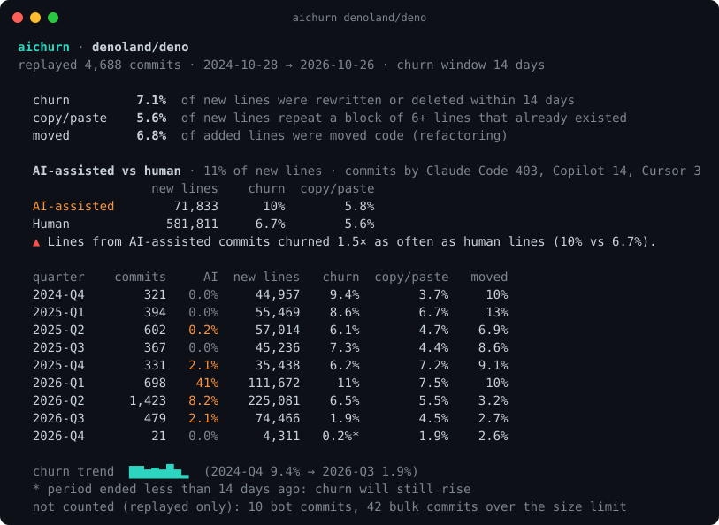
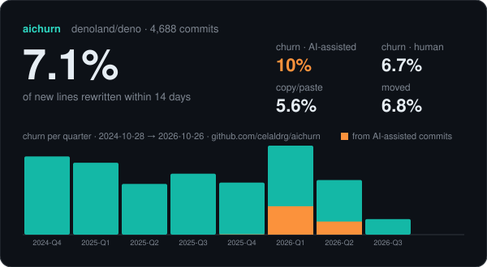

<div align="center">

# aichurn

**Does AI-written code get rewritten faster?**

aichurn replays your git history line by line and measures **two-week churn**, **copy/paste** and **moved code**,
split between AI-assisted commits (Claude Code, Cursor, Copilot, Codex, Aider, Devin, Jules…) and human ones.
Your repo, your numbers, one command.

[](https://github.com/celaldrg/aichurn/actions/workflows/ci.yml)
[](https://github.com/celaldrg/aichurn/releases)
[](LICENSE)




</div>

## Try it

```sh
cargo install --git https://github.com/celaldrg/aichurn
aichurn                      # the repo you are in
aichurn denoland/deno        # any public GitHub repo (cloned shallowly to a temp dir)
```

No Rust? Download a binary for Linux, macOS or Windows from the [latest release](https://github.com/celaldrg/aichurn/releases/latest).
Needs git. No network calls except `git clone` for remote repos, no API keys, no telemetry.

## Why

[GitClear's research](https://www.gitclear.com/the_ai_code_quality_maintainability_gap) made "code churn" the
headline metric of the AI coding debate: code that is rewritten or deleted within two weeks of being written, and
copy/pasted blocks, both rising since AI assistants arrived. Those are averages over many companies, measured
with a commercial tool.

aichurn computes the same kind of signals **for one repository, from its own history, locally**, and adds the
split nobody else gives you: **lines from AI-assisted commits vs lines from human commits, in the same codebase.**

## We ran it on popular repos

`aichurn <repo>` on 2026-10-27, last 2 years of history (or since the repo began). "Churn" = new lines
rewritten or deleted within 14 days. Ratio = AI-assisted churn ÷ human churn.

| Repository | New lines from AI-assisted commits | AI-assisted commits | Churn, AI-assisted | Churn, human | Ratio | Copy/paste, AI / human |
|---|---:|---:|---:|---:|---:|---:|
| [charmbracelet/crush](https://github.com/charmbracelet/crush) | 4.8% | 19 | 34% | 7.2% | **4.72×** | 1.9% / 3.7% |
| [denoland/deno](https://github.com/denoland/deno) | 11% | 422 | 10% | 6.7% | **1.54×** | 5.8% / 5.6% |
| [anthropics/sandbox-runtime](https://github.com/anthropics/sandbox-runtime) | 13% | 34 | 11% | 7.6% | **1.45×** | 8.6% / 3.5% |
| [openai/codex](https://github.com/openai/codex) | 5.0% | 443 | 12% | 9.6% | **1.30×** | 9.0% / 6.6% |
| [microsoft/TypeScript](https://github.com/microsoft/TypeScript) | 12% | 55 | 1.4% | 1.2% | **1.16×** | 7.6% / 17% |
| [dyoshikawa/rulesync](https://github.com/dyoshikawa/rulesync) | 78% | 1,493 | 6.4% | 6.9% | **0.93×** | 9.7% / 10% |
| [google-gemini/gemini-cli](https://github.com/google-gemini/gemini-cli) | 5.6% | 230 | 11% | 12% | **0.91×** | 8.2% / 6.6% |
| [n8n-io/n8n](https://github.com/n8n-io/n8n) | 33% | 3,372 | 4.9% | 5.7% | **0.87×** | 5.1% / 6.9% |
| [cloudflare/workers-sdk](https://github.com/cloudflare/workers-sdk) | 7.9% | 201 | 4.2% | 6.2% | **0.68×** | 7.6% / 9.2% |
| [vercel/next.js](https://github.com/vercel/next.js) | 4.3% | 228 | 6.6% | 10% | **0.64×** | 3.2% / 9.7% |
| [max-sixty/worktrunk](https://github.com/max-sixty/worktrunk) | 60% | 2,260 | 17% | 30% | **0.58×** | 4.3% / 5.7% |
| [obra/superpowers](https://github.com/obra/superpowers) | 32% | 39 | 11% | 31% | **0.37×** | 2.2% / 5.4% |
| [astral-sh/ruff](https://github.com/astral-sh/ruff) | 1.2% | 75 | 1.7% | 8.9% | **0.19×** | 3.0% / 3.6% |

What we learned:

- **There is no single answer.** AI-assisted lines churned more in 5 of these 13 repos, about the same in 2,
  and *less* in 6. "AI code is throwaway code" is not a law; it depends on the team and how they use the agent.
- **Heavy adopters are not the worst.** rulesync (78% of new lines AI-assisted), worktrunk (60%) and n8n (33%) all
  show AI-assisted lines churning as little as or less than human lines.
- **Small samples swing hard.** crush's 4.7× comes from 19 AI-assisted commits; one large rewrite moves it a lot.
  Look at the commit count before the ratio.
- Copy/paste goes both ways too: higher for AI-assisted lines in sandbox-runtime and codex, lower in next.js and TypeScript.



## What it measures

| Metric | Definition |
|---|---|
| **New lines** | Non-blank lines added by a commit, minus lines that were only moved. |
| **Churn** | Share of new lines that were rewritten or deleted within `--window` days (14) of being written. Only lines whose window has fully passed count, so recent work is never undercounted. |
| **Copy/paste** | Share of new lines that sit inside a block of 6 consecutive meaningful lines that already existed somewhere in the repo (or earlier in the same commit). Blank lines, lone braces and comment-only lines (license headers!) are ignored. |
| **Moved** | Share of added lines that were deleted elsewhere in the same commit: refactoring, the thing GitClear found is disappearing. |
| **AI-assisted** | The commit carries an agent's own signature: a `Co-authored-by` trailer, a bot author or a footer such as `Generated with [Claude Code]`. A merge commit counts as AI-assisted when the branch it merged contains such a commit (the same rule a squash merge follows). |

## Usage

```text
aichurn [path | owner/repo | git-url] [options]

  --since <when>          start of the analysis: a date (2025-01-01), an age (90d, 18m, 2y) or "all" (default: 2y)
  --rev <rev>             branch, tag or commit to analyse (default: HEAD)
  --by <quarter|month>    period size (default: quarter)
  --window <days>         churn window in days (default: 14)
  --max-commit-lines <n>  don't count commits that change more lines (default: 5000)
  --all-files             also count docs, data, lockfiles and generated files
  --json                  print the report as JSON
  --markdown              print a Markdown summary
  --card <file.svg>       write a shareable SVG report card
  --badge <file.svg>      write a shields-style badge
  --badge-label <s>       badge label (default: "2-week churn")
  --fail-above <pct>      exit 1 if overall churn is above pct (CI gate)
  --no-color              disable colors (also respects NO_COLOR)
```

### Badge and CI

```sh
aichurn --badge docs/churn.svg --card docs/churn-card.svg
aichurn --since 90d --fail-above 15        # fail CI when churn passes 15%
aichurn --since 1y --markdown >> "$GITHUB_STEP_SUMMARY"
```


## How it works

1. Take a snapshot of every text file at the start of the window (`git grep`), so existing lines are known and
   existing blocks can be matched as copies.
2. Replay the first-parent history oldest-first with zero-context patches (`git log -p --unified=0 -M`).
   Each file is a vector holding, for every line, when it was written and whether the commit was AI-assisted.
   Hunks remove and insert entries; renames move the vector.
3. When a line is removed within the window of its birth, that is churn, counted in the period the line was **written**.
4. A self-check (`AICHURN_VERIFY=1`) compares the reconstructed line count of every file with the real file at the
   end. On every repo above it reports **0 mismatches**.

Speed: denoland/deno (2 years, 4,688 mainline commits, 650k new lines) takes about 25 s including the clone.

## Honest limits

- **Lower bound on AI.** An agent that doesn't sign its commits is counted as human. Editor completions (Copilot
  inline, Cursor Tab) never sign. The "human" side therefore contains some AI-written code.
- **Mainline view.** Churn is measured on the first-parent history. Rework that happens inside a feature branch
  before it merges is invisible, which is usually what you want: it measures code that *landed*.
- **"Rewritten" is line-based.** Reformatting a line counts as rewriting it. Commits that change more than
  `--max-commit-lines` lines (mass formatting, vendoring, generated code) and bot commits are replayed but not counted.
- **Exclusions are heuristics.** Lockfiles, `*.json`, `*.md`, `dist/`, `vendor/`, snapshots, minified and generated
  files are skipped by default. Use `--all-files` to see everything.
- **Correlation, not causation.** Teams tend to use agents for exploratory work, prototypes and migrations, which
  churn more no matter who writes them. Compare trends inside one repo before comparing repos.

## Compared with

| | aichurn | [GitClear](https://www.gitclear.com) | [git-habits](https://github.com/rich-atkins/git-habits) | [code-maat](https://github.com/adamtornhill/code-maat) |
|---|---|---|---|---|
| Line-level churn (birth → death of each line) | yes | yes | no (per-file line counts) | no (file-level) |
| AI-assisted vs human split | yes, per commit signature | research reports; paid product | counts AI co-authored commits | no |
| Copy/paste and moved code | yes | yes | moved only | no |
| Runs locally, open source | yes, single binary | no, SaaS | yes, Python | yes, Clojure |

## Roadmap

- [ ] Per-author and per-directory breakdowns (`--by-dir src/`)
- [ ] "Find/replace" and "updated in place" categories, as in GitClear's taxonomy
- [ ] Branch-aware mode that also measures rework inside feature branches
- [ ] Parallel patch parsing for very large monorepos
- [ ] GitHub Action with a PR comment showing the trend

Ideas and agent signatures are very welcome. See [CONTRIBUTING.md](CONTRIBUTING.md).

## Related

- [aiblame](https://github.com/celaldrg/aiblame): how much of the code at HEAD was written by AI.
- [agentprs](https://github.com/celaldrg/agentprs): how AI agents' pull requests fare (share, merge rate, time to merge).
- Inspired by GitClear's *AI Copilot Code Quality* research. aichurn is an independent, open-source take on the
  same questions; numbers are not directly comparable with GitClear's.

## License

[MIT](LICENSE) © Celalettin Durğaç
